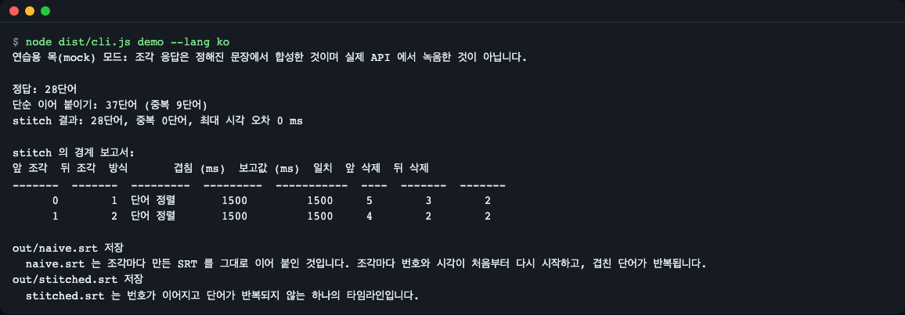
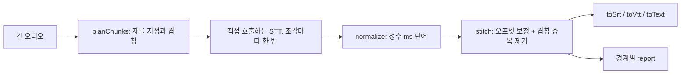
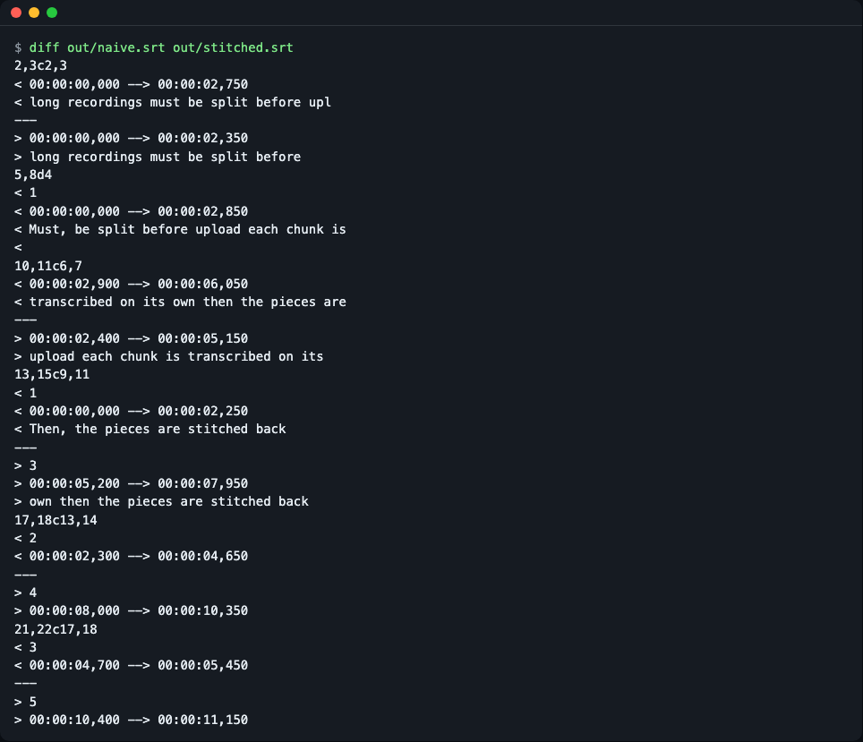
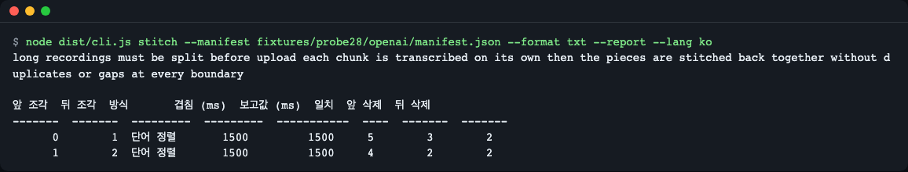
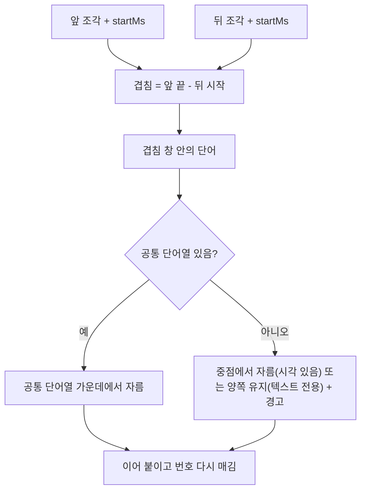
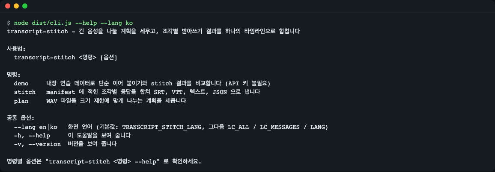

# transcript-stitch

[English](README.md) | **한국어**

[](https://github.com/LeeGyeongPil/transcript-stitch/actions/workflows/ci.yml)  

음성 인식 API(OpenAI, Groq, whisper.cpp)의 크기 제한에 맞게 긴 오디오를 나눌 계획을 세우고, 조각별 받아쓰기 결과를 하나의 타임라인으로 합칩니다. 조각 시작 시각 보정, 겹친 단어 중복 제거, SRT/VTT 번호를 1부터 다시 매기기까지 해 줍니다. TypeScript, 런타임 의존성 0, 같은 입력이면 같은 출력. 설치는 `npm install transcript-stitch`.



*동봉한 연습 데이터로 `node dist/cli.js demo --lang ko` 를 실행한 화면(`npm run demo:ko` 와 같습니다). 단순 이어 붙이기는 중복 9단어가 남고, stitch 결과는 정답 28단어와 같습니다.*

## 왜 필요한가

음성 인식 API 에는 업로드 크기·길이 제한이 있습니다(예: OpenAI 전사 엔드포인트는 요청당 25MB, [OpenAI 문서](https://platform.openai.com/docs/guides/speech-to-text) 참고). 긴 녹음은 조각으로 잘라 보내야 하는데, 돌아온 결과는 그냥 이어 붙이면 안 됩니다.

- **중복 단어.** 조각은 일부러 겹치게 자르므로 겹친 단어가 두 번 나옵니다.
- **다시 시작하는 시계.** 조각마다 `00:00` 에서 시작하고 자막 번호도 1부터 다시 시작합니다.
- **잘린 단어.** 조각 끝에서 단어가 잘립니다(`upload` 가 `upl` 로).
- **단위 혼동.** 초와 밀리초, 조각 기준 시각과 원본 기준 시각이 섞입니다.

두루마리를 여러 장으로 나눠 베낀 뒤 쪽 번호를 손으로 다시 매기는 일과 같습니다. 각 장이 어디서 시작했는지 알아야 하고, 두 장이 같이 베낀 줄은 하나를 지워야 합니다. `transcript-stitch` 가 이 계산을 대신하고, 경계마다 무엇을 했는지 보고서로 알려 줍니다.



"긴 오디오"와 "직접 호출하는 STT"를 뺀 나머지 상자(계획 `planChunks`, 정규화, 합치기, 자막 출력)를 라이브러리가 맡습니다. 오디오를 자르거나 API 를 호출하지는 않습니다.

## 설치

```bash
npm install transcript-stitch
```

실행 환경: Node.js 20.19 이상(ESM). 런타임 의존성: 0. 이 저장소를 개발하려면 Node.js 22.12 이상이 필요합니다(테스트 도구 요구 사항).

API 키 없이 소스에서 바로 써 보려면:

```bash
git clone https://github.com/LeeGyeongPil/transcript-stitch
cd transcript-stitch
npm install
npm run demo
```

## 빠르게 시작하기

`examples/basic.mjs` 입니다(`npm run build` 뒤에 실행하세요. `npm run demo` 는 알아서 빌드합니다). `chunks` 는 조각마다 하나씩, 원본 오디오에서 시작하는 위치와 API 원본 응답을 담습니다.

```js
import { readFileSync } from 'node:fs';
import { stitch, toSrt } from 'transcript-stitch'; // 이 저장소 안에서는 '../dist/index.js'

const dir = new URL('../fixtures/probe28/openai/', import.meta.url);
const manifest = JSON.parse(readFileSync(new URL('manifest.json', dir), 'utf8'));

const chunks = manifest.chunks.map((c) => ({
  startMs: c.startMs,
  endMs: c.endMs,
  result: JSON.parse(readFileSync(new URL(c.file, dir), 'utf8')),
}));

const result = stitch(chunks);
process.stdout.write(toSrt(result));
```

```text
1
00:00:00,000 --> 00:00:02,350
long recordings must be split before

2
00:00:02,400 --> 00:00:05,150
upload each chunk is transcribed on its

3
00:00:05,200 --> 00:00:07,950
own then the pieces are stitched back

4
00:00:08,000 --> 00:00:10,350
together without duplicates or gaps at

5
00:00:10,400 --> 00:00:11,150
every boundary
```

### 연습용 목(mock) 모드

동봉한 `fixtures/` 는 **실제 API 에서 녹음한 응답이 아니라 연습용 목(mock) 응답**입니다. 정해진 문장에서 합성해 겹치게 자르고, 실제 조각 가장자리처럼 일부러 손상시켰습니다(잘린 단어, 대문자로 시작하는 첫 단어, 조각 시작보다 앞선 시각). 그래서 데모가 정답을 정확히 계산할 수 있습니다. 실제 API 응답은 다를 수 있습니다. 두 조각이 겹친 구간을 다르게 들으면 `stitch` 는 경고를 보고하고, 시각이 있는 응답은 겹침의 가운데에서 자릅니다(텍스트 전용 응답은 양쪽을 모두 남깁니다). 선택 옵션 `fuzzy`(CLI `--fuzzy`)를 켜면 조금 다른 단어도 맞춥니다. [fixtures/README.md](fixtures/README.md) 를 보세요.

## 단계별 따라 하기

**1. 데모를 실행합니다.** 키도 네트워크도 필요 없습니다.

```bash
env -u OPENAI_API_KEY -u GROQ_API_KEY npm run demo:ko
```

```text
연습용 목(mock) 모드: 조각 응답은 정해진 문장에서 합성한 것이며 실제 API 에서 녹음한 것이 아닙니다.

정답: 28단어
단순 이어 붙이기: 37단어 (중복 9단어)
stitch 결과: 28단어, 중복 0단어, 최대 시각 오차 0 ms

stitch 의 경계 보고서:
앞 조각  뒤 조각  방식       겹침 (ms)  보고값 (ms)  일치  앞 삭제  뒤 삭제
-------  -------  ---------  ---------  -----------  ----  -------  -------
      0        1  단어 정렬       1500         1500     5        3        2
      1        2  단어 정렬       1500         1500     4        2        2
```

- `단순 이어 붙이기` 는 조각을 그대로 붙인 결과, `stitch 결과` 는 `stitch` 의 결과, `정답` 은 연습 데이터를 만든 원래 문장입니다.
- `앞 삭제` / `뒤 삭제` 는 겹침 구간에서 앞·뒤 조각에서 지운 단어 수, `일치` 는 두 조각을 맞추는 데 쓴 공통 단어열의 길이입니다.
- 데모는 이 출력 아래에 `out/naive.srt` 와 `out/stitched.srt` 도 씁니다.

**2. 두 자막 파일을 비교합니다.**

```bash
diff out/naive.srt out/stitched.srt
```



*왼쪽 줄(`<`)이 단순 이어 붙이기 파일입니다: 번호가 1부터 다시 시작하고 `upl` 이 잘린 단어입니다. 오른쪽 줄(`>`)이 stitch 결과입니다.*

**3. 경계별 보고서를 읽습니다.** `--report` 는 stderr 로 출력하므로 본문과 섞이지 않습니다.

```bash
node dist/cli.js stitch --manifest fixtures/probe28/openai/manifest.json --format txt --report --lang ko
```



*stdout 의 본문과 그 아래 경계 표.*

## 핵심 개념

1. **단위는 정수 밀리초 하나.** `normalize` 는 초 단위 응답을 정수 ms 로 반올림하고 `stitch` 는 조각 `startMs` 를 반올림해서, 부동소수 오차(`188595.00000000003`)가 1ms 틈이나 겹침을 만들지 못합니다.
2. **겹침은 믿지 않고 계산합니다.** 실제 겹침 = 앞 조각의 `endMs` − 뒤 조각의 `startMs`. 분할 도구가 *보고한* 값은 `report.boundaries[].reportedOverlapMs` 에만 적고, 다르면 `REPORTED_OVERLAP_DIFFERS` 경고를 냅니다.
3. **중복 제거 = 최장 공통 연속열.** 겹침 창 안에서 두 조각의 정규화한 단어를 비교해 가장 긴 공통 단어열을 찾고, 그 가운데에서 자릅니다. 잘린 조각(`upl`)은 온전한 단어(`upload`)에 밀립니다.
4. **결과는 항상 냅니다.** 겹침에서 일치가 없으면, 시각이 있는(단어·구간) 응답은 겹침 가운데에서 자르고 `NO_MATCH` 경고를 붙입니다(`onNoMatch: 'keep-both'` 로 둘 다 남길 수도 있습니다). 텍스트 전용 응답은 시각이 없어 시간으로 자를 수 없으므로 양쪽을 모두 남기고(method `text`) `NO_MATCH` 경고를 붙이며, 겹친 단어가 중복으로 나올 수 있습니다. 두 조각이 일부 단어만 조금 다르게 적었다면(`seconds` / `second`) 선택 옵션 `fuzzy: true`(CLI `--fuzzy`)가 유사도(Jaro-Winkler, 문턱값 0.85, `fuzzy` 에 0 초과 1 이하의 숫자를 줄 수도 있음)로 맞춥니다. 기본값은 끔이고, 3글자 미만 단어는 여전히 정확 일치만 보며, 반복 구절은 잘못 정렬될 수 있으니 보고서를 확인하세요.



## API

모든 시각은 정수 밀리초입니다. 오류는 고정된 `code` 를 가진 `StitchError` 입니다(아래 표).

| 이름 | 하는 일 | 주요 인자 | 반환 |
|---|---|---|---|
| `normalize(resp, { provider })` | 응답 하나(OpenAI·Groq `verbose_json`, whisper.cpp `verbose_json`, 텍스트만)를 공통 형식으로 바꿉니다. | `resp`, `provider`: `auto`(기본), `openai`, `groq`, `whispercpp`, `text` | `Transcript` |
| `detectProvider(resp)` | 응답 형식을 추정합니다. | `resp` | `'openai' \| 'groq' \| 'whispercpp' \| 'text'` |
| `stitch(chunks, opts)` | 시작 시각을 보정하고 중복을 없애 하나의 타임라인으로 합칩니다. | `chunks: { startMs, endMs?, result, provider?, overlapMs? }[]`; `opts`: `minMatchWords`, `windowSlackMs`, `maxWordDriftMs`, `onNoMatch`, `fuzzy`(`false` 기본값, `true` 는 유사도 0.85, 또는 0 초과 1 이하의 문턱값) | `Stitched` (`Transcript` + `report`) |
| `naiveConcat(chunks)` | 그냥 붙였을 때의 결과(비교·테스트용). | 같은 `chunks` | `Stitched` |
| `toSrt` / `toVtt(t, opts)` | 자막 텍스트. 큐 번호는 1부터, 서로 겹치지 않습니다. | `Transcript`; `maxChars`(42), `maxCueMs`(7000) | `string` |
| `toText(t, opts)` | 일반 텍스트. 긴 쉼에서 문단을 나눕니다. | `Transcript`; `paragraphGapMs`(2000) | `string` |
| `planChunks(opts)` | 크기·길이·최소 길이를 지키는 분할 계획. | `durationMs`, `bytesPerSecond`, `maxBytes`(숫자 또는 `'25mb'`), `headerBytes`(44), `safetyRatio`(0.98), `maxDurationMs`, `minChunkMs`(10000), `overlapMs`(0), `silences` | `PlannedChunk[]` |
| `readWavInfo(bytes)` | PCM WAV 헤더를 읽습니다. | `Uint8Array` | `WavInfo` |
| `readWavSamples(bytes)` | 헤더와 16비트 샘플. | `Uint8Array` | `{ info, samples }` |
| `detectSilences(samples, sampleRate, opts)` | RMS 에너지로 조용한 구간을 찾습니다. | `thresholdDb`(-40), `minSilenceMs`(400), `frameMs`(20) | `TimeRange[]` |
| `parseSize(v)` / `parseDuration(v)` | `'25mb'` 를 바이트로, `'1.5s'` 를 ms 로. | 숫자 또는 문자열 | `number` |

`Stitched.report` 는 `boundaries[]`(`left`, `right`, `actualOverlapMs`, `reportedOverlapMs`, `method`: `words` / `text` / `midpoint` / `adjacent`, `matchedWords`, `droppedLeft`, `droppedRight`, `warnings`)와 `warnings[]` 를 가집니다. 경고는 `{ code, message, boundary, data }` 이고 code 는 `NO_MATCH`, `GAP`, `EMPTY_CHUNK`, `UNKNOWN_END`, `REPORTED_OVERLAP_DIFFERS`, `MIXED_TIMESTAMPS` 입니다.

| 오류 code | 언제 |
|---|---|
| `BAD_INPUT` | 인자가 없거나 잘못됨. |
| `UNKNOWN_FORMAT` | 지원하는 어떤 응답 모양과도 맞지 않음. |
| `NON_MONOTONIC` | 조각 시작 시각이 거꾸로 감. |
| `NO_TIMESTAMPS` | SRT/VTT 를 요청했는데 조각이 텍스트뿐임. |
| `PLAN_IMPOSSIBLE` | 제한을 지킬 수 없음(예: 크기 제한이 겹침보다 작음). |
| `BAD_WAV` | 16비트 PCM WAV 가 아님. |

이 표는 라이브러리의 `StitchError` 코드만 담았습니다. CLI 는 매니페스트나 오디오 파일 경로가 없으면 `FILE_NOT_FOUND`(종료 코드 2)도 보고합니다.

## 사용 예

### 텍스트만 있는 응답(타임스탬프 없음)

`{ text }` 만 돌려주는 모델도 됩니다. 토큰을 정렬해 겹침을 없애며, `hasTimestamps` 는 `false` 이므로 `toSrt` 는 시각을 지어내지 않고 `NO_TIMESTAMPS` 를 던집니다.

```js
import { stitch } from 'transcript-stitch';

const r = stitch([
  { startMs: 0, result: 'one two three four' },
  { startMs: 1000, result: 'three four five six' },
]);
console.log(r.text, r.hasTimestamps, r.report.boundaries[0].method);
```

```text
one two three four five six false text
```

CLI 로는 `node dist/cli.js stitch --manifest fixtures/probe28/text/manifest.json --format txt` 가 28단어 문장을 한 줄로 냅니다.

### 조각 나누기 계획

`planChunks` 는 모든 조각을 `maxBytes * safetyRatio`(헤더 포함) 이하, `maxDurationMs` 이하로 만들고, 마지막 조각을 빼면 `minChunkMs` 이상으로 만듭니다. `25mb` 는 십진 메가바이트(25,000,000바이트)로, 제한을 더 작게 읽는 쪽입니다. `24mib` 도 쓸 수 있습니다.

```js
import { planChunks } from 'transcript-stitch';

const plan = planChunks({ durationMs: 120000, bytesPerSecond: 32000, maxBytes: '1mb', overlapMs: 1500 });
console.log(plan.map((c) => `${c.index} ${c.startMs}-${c.endMs} ${c.estBytes} forceSplit=${c.forceSplit}`).join('\n'));
```

```text
0 0-30623 979980 forceSplit=true
1 29123-59746 979980 forceSplit=true
2 58246-88869 979980 forceSplit=true
3 87369-117992 979980 forceSplit=true
4 116492-120000 112300 forceSplit=false
```

무음 정보가 없으면 모든 자름이 `forceSplit` 입니다. `silences`(`detectSilences` 결과나 직접 만든 무음 목록)를 넘기면 무음 안에서 자릅니다. WAV 파일이면 CLI 가 두 단계를 모두 합니다. 아래 표는 합성 `talk.wav`(동봉하지 않음)의 결과입니다. 120초, 16 kHz, 모노, 16비트 PCM(초당 32000 바이트)이고, 7초 단위 블록마다 6.2초~7.0초가 무음인 톤입니다(7초의 배수에서 끝나는 0.8초 무음, 예: 27.2초~28.0초). 직접 만든 파일은 숫자가 다를 수 있습니다.

```bash
npx transcript-stitch plan talk.wav --max-size 1mb --overlap 1.5s --lang ko
```

```text
talk.wav: 00:02:00.000, 초당 32000 바이트, 조각 5개, 무음 구간 17개 발견

번호  시작          끝            예상 바이트  자르기 
----  ------------  ------------  -----------  -------
   0  00:00:00.000  00:00:27.600       883244  무음 안
   1  00:00:26.100  00:00:55.600       944044  무음 안
   2  00:00:54.100  00:01:23.600       944044  무음 안
   3  00:01:22.100  00:01:51.600       944044  무음 안
   4  00:01:50.100  00:02:00.000       316844  -
```

`--ffmpeg` 는 표 대신 조각마다 명령 한 줄을 냅니다(라이브러리가 오디오를 직접 자르지는 않습니다).

```text
ffmpeg -ss 0.000 -t 27.600 -i talk.wav -c copy talk-chunk-000.wav
ffmpeg -ss 26.100 -t 29.500 -i talk.wav -c copy talk-chunk-001.wav
```

### 오디오 분할 도구와 함께 쓰기

분할 도구가 보고하는 `overlapMs` 가 실제로 만든 겹침과 다를 수 있습니다. `stitch` 는 `overlapMs` 를 보고서용 참고값으로만 기록하고, 실제 겹침은 조각 경계 시각으로 다시 계산합니다. 실제 겹침이 0(조각이 맞닿음)이면 방식은 `adjacent` 이고 지우는 단어는 없습니다. npm 패키지 [`audio-chunker`](https://www.npmjs.com/package/audio-chunker) 가 이렇게 출력을 넘길 수 있는 분할 도구 중 하나입니다. 옵션은 해당 문서를 확인하세요.

## CLI

```bash
transcript-stitch <demo|stitch|plan> [options]
```

| 명령 | 옵션 |
|---|---|
| `demo` | `--out-dir <dir>` (기본 `out`). 동봉한 연습 데이터로 단순 이어 붙이기와 stitch 를 비교하고 `out/naive.srt`, `out/stitched.srt` 를 씁니다 |
| `stitch --manifest <file>` | `--provider auto\|openai\|groq\|whispercpp\|text`, `--format srt\|vtt\|txt\|json`, `-o <file>`, `--fuzzy`, `--report`, `--strict`(경고가 있으면 종료 1) |
| `plan <file.wav> --max-size <size>` | `--max-duration`, `--overlap`, `--min-chunk`, `--ffmpeg`, `--json` |

종료 코드: 0 정상, 1 `--strict` 에서 경고, 2 사용법·입력 오류, 3 계획 불가.

manifest 는 JSON 입니다: `{ "chunks": [{ "file": "chunk-0.json", "startMs": 0, "endMs": 2600 }, ...] }`. 파일 이름은 manifest 기준 상대 경로이고, `.txt` 조각 파일은 일반 텍스트로 읽습니다.

### 화면 언어

CLI 는 영어와 한국어를 지원합니다. 우선순위는 `--lang en|ko`, 그다음 `TRANSCRIPT_STITCH_LANG`, 그다음 `LC_ALL` / `LC_MESSAGES` / `LANG` 입니다(`ko` 로 시작하면 한국어, 그 밖은 영어).

```bash
node dist/cli.js --help --lang ko
```



*한국어 도움말 화면. `--lang en` 은 영어 화면입니다.*

## 실제 모드

라이브러리는 넣어 주는 응답에 대해 동작합니다. 제공자 API 는 직접 호출하고(예: 조각마다 요청 한 번), 응답을 `stitch` 에 넘기세요. 실제 API 는 사용량만큼 과금되고 느릴 수 있으며, 공유 CPU 의 로컬 whisper.cpp 서버는 더 느릴 수 있으니 먼저 연습 데이터로 시험하세요. 바로 쓸 수 있는 실제 모드 예제는 이번 버전에 없습니다. `.env.example` 은 이후 예제가 읽을 선택 변수를 적어 둔 것이고, 라이브러리·테스트·데모는 키도 네트워크도 필요 없습니다.

## 언제 쓰나

- 잘 맞는 경우: 긴 오디오를 이미 나눴고(ffmpeg 나 분할 도구) 조각 결과를 깨끗한 타임라인 하나로 합치고 싶을 때, 또는 업로드 제한을 지키는 분할 계획이 필요할 때.
- 다루지 않는 것: 오디오 자르기, 받아쓰기 API 호출, 띄어쓰기 없는 언어(글자 단위 정렬은 아직 없음), 두 조각이 다르게 들은 단어(철자·단복수처럼 조금 다른 경우는 선택 옵션 `fuzzy` 를 켜야만 맞추고, 그 외에는 시각이 있는 응답의 중점 자르기 폴백, 텍스트 전용은 양쪽 유지).
- 다른 도구: 오디오 분할은 [`audio-chunker`](https://www.npmjs.com/package/audio-chunker) 나 [ffmpeg](https://ffmpeg.org/), Groq 의 [음성 인식 문서](https://console.groq.com/docs/speech-to-text) 는 나누기·처리·합치기 방식을 설명합니다.

## 버전

유의적 버전(SemVer)을 따릅니다. 0.x 동안은 마이너 버전에서 API 가 바뀔 수 있고, 바뀌면 [CHANGELOG.md](CHANGELOG.md) 에 적습니다. 현재 버전: 0.2.0.

## 개발

Node.js 22.12 이상이 필요합니다.

```bash
npm install
npm test            # 먼저 빌드합니다. 테스트 파일 8개, 테스트 313개
npm run typecheck
npm run check:package
npm run fixtures    # 연습 데이터 다시 만들기(결정적)
```

## 자주 겪는 문제

| 증상 | 원인 | 해결 |
|---|---|---|
| `NO_MATCH` 경고 | 두 조각이 겹친 단어를 다르게 들었거나 겹침이 너무 짧음. | 결과는 나옵니다. 시각이 있는 응답은 중점에서 자르고, 텍스트 전용 응답은 시간으로 자를 수 없어 양쪽을 모두 남기므로 겹친 단어가 중복으로 나올 수 있습니다. 타임스탬프를 요청하거나 겹침을 1.5초 이상으로 늘리세요. 단어가 조금만 다르면 `--fuzzy`(라이브러리는 `fuzzy: true`)를 켜 보세요. |
| `REPORTED_OVERLAP_DIFFERS` | 분할 도구가 보고한 겹침이 실제와 다름. | 고칠 것 없음. 경계 시각으로 계산한 실제 겹침을 씁니다. |
| `toSrt` 에서 `NO_TIMESTAMPS` | 응답이 텍스트뿐임. | `toText` 를 쓰거나 API 에 단어·문장 타임스탬프를 요청하세요. |
| CLI 가 한국어로 나옴 (`node dist/cli.js`, `npx transcript-stitch`) | `LANG` 이 `ko` 로 시작함. | `--lang en` 을 붙이거나 `TRANSCRIPT_STITCH_LANG=en` 을 설정하세요. `npm run demo` 는 항상 영어, `npm run demo:ko` 는 항상 한국어입니다. |
| 설치 뒤 `npm test` 실패 | Node.js 가 22.12 보다 낮음. | 개발에는 Node.js 22.12 이상, 빌드된 라이브러리 실행에는 20.19 이상이면 됩니다. |

## 라이선스

MIT, [LICENSE](LICENSE) 참고.
