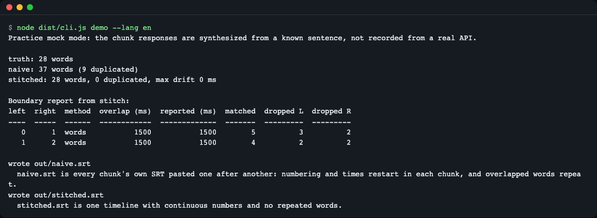
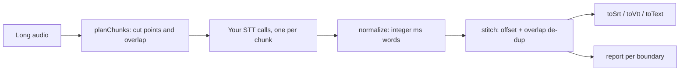
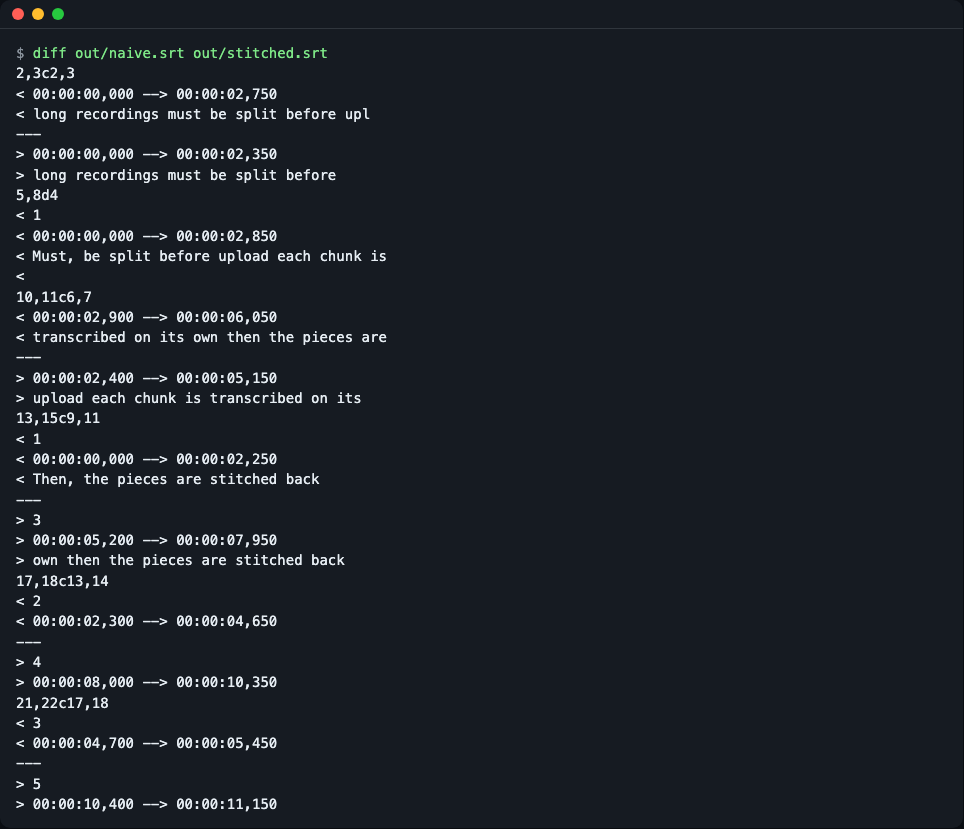
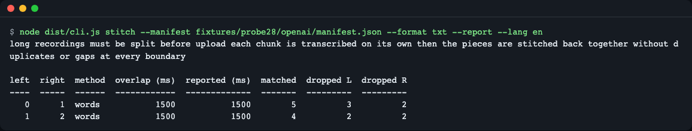
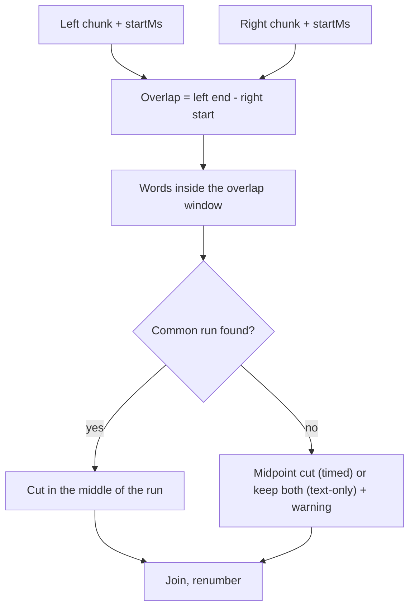
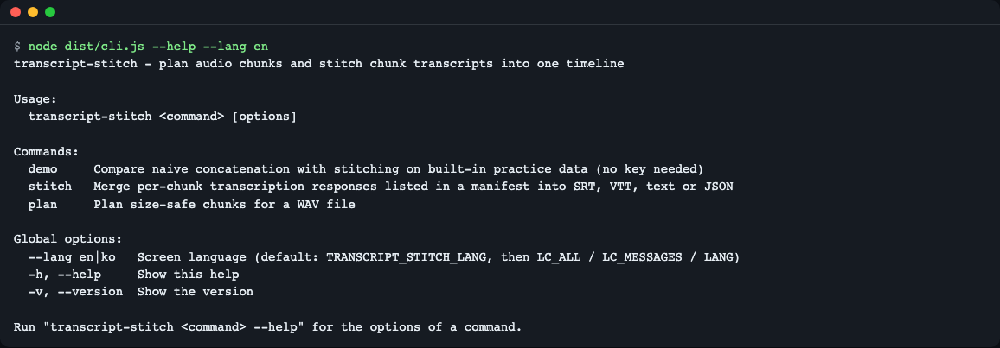

# transcript-stitch

**English** | [한국어](README.ko.md)

[](https://github.com/LeeGyeongPil/transcript-stitch/actions/workflows/ci.yml)  

Plan size-safe audio chunks for speech-to-text APIs (OpenAI, Groq, whisper.cpp), then stitch the per-chunk transcripts back into one timeline: chunk offsets fixed, overlapped words de-duplicated, SRT/VTT numbered from 1. TypeScript, zero runtime dependencies, deterministic output. Install with `npm install transcript-stitch`.



*`npm run demo` on the bundled practice data: the naive result has 9 duplicated words, the stitched result matches the 28-word truth.*

## Why

Speech-to-text APIs limit upload size and length (for example 25 MB per request for OpenAI's transcription endpoint, see the [OpenAI docs](https://platform.openai.com/docs/guides/speech-to-text)). A long recording has to be cut into chunks, and the pieces that come back do not simply concatenate:

- **Duplicated words.** Chunks overlap on purpose, so the overlapped words appear twice.
- **Restarting clocks.** Every chunk starts at `00:00`; the subtitle numbers restart too.
- **Cut words.** A chunk can end in the middle of a word (`upl` instead of `upload`).
- **Mixed units.** Seconds vs milliseconds, chunk-relative vs original-audio times.

Think of copying a scroll in several strips, then renumbering the pages by hand: you have to know where each strip started and drop the lines that two strips both copied. `transcript-stitch` does that bookkeeping and tells you, per boundary, what it did.



The library covers every box except "Long audio" and "Your STT calls": planning (`planChunks`), normalizing, stitching and subtitle output. It does not cut audio and does not call any API.

## Install

```bash
npm install transcript-stitch
```

Runtime: Node.js 20.19 or newer (ESM). Runtime dependencies: 0. Developing this repository needs Node.js 22.12 or newer (the test runner requires it).

To try it from source without any API key:

```bash
git clone https://github.com/LeeGyeongPil/transcript-stitch
cd transcript-stitch
npm install
npm run demo
```

## Quick start

`examples/basic.mjs` (run it after `npm run build`, or `npm run demo` builds for you). `chunks` is one entry per chunk: where it starts in the original audio and the raw API response.

```js
import { readFileSync } from 'node:fs';
import { stitch, toSrt } from 'transcript-stitch'; // in this repo: '../dist/index.js'

const dir = new URL('../fixtures/probe28/openai/', import.meta.url);
const manifest = JSON.parse(readFileSync(new URL('manifest.json', dir), 'utf8'));

const chunks = manifest.chunks.map((c) => ({
  startMs: c.startMs,
  endMs: c.endMs,
  result: JSON.parse(readFileSync(new URL(c.file, dir), 'utf8')),
}));

const result = stitch(chunks);
process.stdout.write(toSrt(result));
```

```text
1
00:00:00,000 --> 00:00:02,350
long recordings must be split before

2
00:00:02,400 --> 00:00:05,150
upload each chunk is transcribed on its

3
00:00:05,200 --> 00:00:07,950
own then the pieces are stitched back

4
00:00:08,000 --> 00:00:10,350
together without duplicates or gaps at

5
00:00:10,400 --> 00:00:11,150
every boundary
```

### Practice (mock) mode

The bundled `fixtures/` are **practice (mock) responses, not recordings of a real API.** They are synthesized from a known sentence, cut into overlapping chunks, and damaged the way real chunk edges are (cut words, capitalized first words, times before the chunk start). That lets the demo compute the exact truth. Real API responses can differ: two chunks may hear the overlapped words differently, in which case `stitch` reports a warning and, for timed responses, falls back to cutting at the middle of the overlap (text-only responses keep both sides). See [fixtures/README.md](fixtures/README.md).

## Step by step

**1. Run the demo.** No key, no network.

```bash
env -u OPENAI_API_KEY -u GROQ_API_KEY npm run demo
```

```text
Practice mock mode: the chunk responses are synthesized from a known sentence, not recorded from a real API.

truth: 28 words
naive: 37 words (9 duplicated)
stitched: 28 words, 0 duplicated, max drift 0 ms

Boundary report from stitch:
left  right  method  overlap (ms)  reported (ms)  matched  dropped L  dropped R
----  -----  ------  ------------  -------------  -------  ---------  ---------
   0      1  words           1500           1500        5          3          2
   1      2  words           1500           1500        4          2          2

wrote out/naive.srt
  naive.srt is every chunk's own SRT pasted one after another: numbering and times restart in each chunk, and overlapped words repeat.
wrote out/stitched.srt
  stitched.srt is one timeline with continuous numbers and no repeated words.
```

- `naive` pastes the chunks together; `stitched` is `stitch`'s result; `truth` is the sentence the practice data came from.
- `dropped L` / `dropped R` count the words removed from the left and right chunk inside the overlap; `matched` is the length of the common run used to align them.

**2. Compare the two subtitle files.**

```bash
diff out/naive.srt out/stitched.srt
```



*Left lines (`<`) are the naive file: numbers restart at 1 and `upl` is a cut word. Right lines (`>`) are stitched.*

**3. Read the per-boundary report.** `--report` prints it to stderr, so it never mixes with the transcript.

```bash
node dist/cli.js stitch --manifest fixtures/probe28/openai/manifest.json --format txt --report --lang en
```



*The transcript on stdout, the boundary table below it.*

## Core concepts

1. **One unit: integer milliseconds.** `normalize` rounds second-based responses to integer ms and `stitch` rounds chunk `startMs`, so floating point noise (`188595.00000000003`) cannot create 1 ms gaps or overlaps.
2. **The overlap is computed, not trusted.** Actual overlap is `endMs` of the left chunk minus `startMs` of the right chunk. What a splitter *reported* is recorded in `report.boundaries[].reportedOverlapMs` and a `REPORTED_OVERLAP_DIFFERS` warning is raised if it disagrees.
3. **De-duplication = longest common run.** Inside the overlap window the normalized words of both chunks are compared, the longest common run of words is found, and the cut is made in the middle of that run. A cut piece (`upl`) loses against the whole word (`upload`).
4. **Always a result.** No match in the overlap: for timed (word or segment) responses, cut at the middle of the overlap and add a `NO_MATCH` warning (or keep both with `onNoMatch: 'keep-both'`). Text-only responses have no timestamps and cannot be cut by time, so both sides are kept (method `text`) with a `NO_MATCH` warning, and the overlapped words may appear twice.



## API

All times are integer milliseconds. Errors are `StitchError` with a stable `code` (table below).

| Name | What it does | Main arguments | Returns |
|---|---|---|---|
| `normalize(resp, { provider })` | Turns one raw response (OpenAI/Groq `verbose_json`, whisper.cpp `verbose_json`, or text only) into the common format. | `resp`, `provider`: `auto` (default), `openai`, `groq`, `whispercpp`, `text` | `Transcript` |
| `detectProvider(resp)` | Guesses the response shape. | `resp` | `'openai' \| 'groq' \| 'whispercpp' \| 'text'` |
| `stitch(chunks, opts)` | Offsets, de-duplicates and joins chunks into one timeline. | `chunks: { startMs, endMs?, result, provider?, overlapMs? }[]`; `opts`: `minMatchWords`, `windowSlackMs`, `maxWordDriftMs`, `onNoMatch` | `Stitched` (`Transcript` + `report`) |
| `naiveConcat(chunks)` | What plain pasting gives (for comparison and tests). | same `chunks` | `Stitched` |
| `toSrt` / `toVtt(t, opts)` | Subtitle text, cues numbered from 1, never overlapping. | `Transcript`; `maxChars` (42), `maxCueMs` (7000) | `string` |
| `toText(t, opts)` | Plain text, paragraph break at long pauses. | `Transcript`; `paragraphGapMs` (2000) | `string` |
| `planChunks(opts)` | Chunk plan that respects size, length and minimum length. | `durationMs`, `bytesPerSecond`, `maxBytes` (number or `'25mb'`), `headerBytes` (44), `safetyRatio` (0.98), `maxDurationMs`, `minChunkMs` (10000), `overlapMs` (0), `silences` | `PlannedChunk[]` |
| `readWavInfo(bytes)` | Reads a PCM WAV header. | `Uint8Array` | `WavInfo` |
| `readWavSamples(bytes)` | Header plus 16-bit samples. | `Uint8Array` | `{ info, samples }` |
| `detectSilences(samples, sampleRate, opts)` | Finds quiet ranges by RMS energy. | `thresholdDb` (-40), `minSilenceMs` (400), `frameMs` (20) | `TimeRange[]` |
| `parseSize(v)` / `parseDuration(v)` | `'25mb'` to bytes, `'1.5s'` to ms. | number or string | `number` |

`Stitched.report` has `boundaries[]` (`left`, `right`, `actualOverlapMs`, `reportedOverlapMs`, `method`: `words` / `text` / `midpoint` / `adjacent`, `matchedWords`, `droppedLeft`, `droppedRight`, `warnings`) and `warnings[]`. Each warning is `{ code, message, boundary, data }`; codes: `NO_MATCH`, `GAP`, `EMPTY_CHUNK`, `UNKNOWN_END`, `REPORTED_OVERLAP_DIFFERS`, `MIXED_TIMESTAMPS`.

| Error code | When |
|---|---|
| `BAD_INPUT` | Missing or invalid argument. |
| `UNKNOWN_FORMAT` | The response matches no supported shape. |
| `NON_MONOTONIC` | Chunk start times go backwards. |
| `NO_TIMESTAMPS` | You asked for SRT/VTT but the chunks are text only. |
| `PLAN_IMPOSSIBLE` | The limits cannot be met (for example the size limit is smaller than the overlap). |
| `BAD_WAV` | Not a 16-bit PCM WAV. |

The table lists the library's `StitchError` codes. The CLI also reports `FILE_NOT_FOUND` (exit 2) when a manifest or audio file path does not exist.

## Usage examples

### Text-only responses (no timestamps)

Models that return only `{ text }` still work. The overlap is de-duplicated by aligning tokens; `hasTimestamps` is `false`, so `toSrt` throws `NO_TIMESTAMPS` instead of inventing times.

```js
import { stitch } from 'transcript-stitch';

const r = stitch([
  { startMs: 0, result: 'one two three four' },
  { startMs: 1000, result: 'three four five six' },
]);
console.log(r.text, r.hasTimestamps, r.report.boundaries[0].method);
```

```text
one two three four five six false text
```

From the CLI: `node dist/cli.js stitch --manifest fixtures/probe28/text/manifest.json --format txt` prints the 28-word sentence on one line.

### Planning chunks

`planChunks` keeps every chunk under `maxBytes * safetyRatio` (header included), under `maxDurationMs`, and at least `minChunkMs` long except the last. `25mb` means decimal megabytes (25,000,000 bytes), the smaller reading of the limit; `24mib` is also accepted.

```js
import { planChunks } from 'transcript-stitch';

const plan = planChunks({ durationMs: 120000, bytesPerSecond: 32000, maxBytes: '1mb', overlapMs: 1500 });
console.log(plan.map((c) => `${c.index} ${c.startMs}-${c.endMs} ${c.estBytes} forceSplit=${c.forceSplit}`).join('\n'));
```

```text
0 0-30623 979980 forceSplit=true
1 29123-59746 979980 forceSplit=true
2 58246-88869 979980 forceSplit=true
3 87369-117992 979980 forceSplit=true
4 116492-120000 112300 forceSplit=false
```

Without silence information every cut is a `forceSplit`. Pass `silences` (from `detectSilences`, or your own silence detector) and cuts go inside them. For a WAV file the CLI does both steps. The table below is for a synthetic `talk.wav` (not shipped): 120 seconds, 16 kHz, mono, 16-bit PCM (32000 bytes/s), a tone that is silent from 6.2 s to 7.0 s of every 7-second block (that is, 0.8 s of silence ending at each multiple of 7 s, such as 27.2 s to 28.0 s). Use your own file and your numbers will differ:

```bash
npx transcript-stitch plan talk.wav --max-size 1mb --overlap 1.5s --lang en
```

```text
talk.wav: 00:02:00.000, 32000 bytes/s, 5 chunk(s), 17 silence(s) found

no.  start         end           est. bytes  cut    
---  ------------  ------------  ----------  -------
  0  00:00:00.000  00:00:27.600      883244  silence
  1  00:00:26.100  00:00:55.600      944044  silence
  2  00:00:54.100  00:01:23.600      944044  silence
  3  00:01:22.100  00:01:51.600      944044  silence
  4  00:01:50.100  00:02:00.000      316844  -      
```

`--ffmpeg` prints one command per chunk instead (the library never cuts audio itself):

```text
ffmpeg -ss 0.000 -t 27.600 -i talk.wav -c copy talk-chunk-000.wav
ffmpeg -ss 26.100 -t 29.500 -i talk.wav -c copy talk-chunk-001.wav
```

### Using it with an audio splitter

A splitter's own `overlapMs` may not match what it really produced. `stitch` takes `overlapMs` only as a hint for the report and recomputes the real overlap from the chunk boundary times. If the real overlap is 0 (chunks touch), the method is `adjacent` and nothing is dropped. The npm package [`audio-chunker`](https://www.npmjs.com/package/audio-chunker) is one splitter whose output you can feed in this way; check its own docs for its options.

## CLI

```bash
transcript-stitch <demo|stitch|plan> [options]
```

| Command | Options |
|---|---|
| `demo` | `--out-dir <dir>` (default `out`); compares naive and stitched on the bundled practice data, writes `out/naive.srt` and `out/stitched.srt` |
| `stitch --manifest <file>` | `--provider auto\|openai\|groq\|whispercpp\|text`, `--format srt\|vtt\|txt\|json`, `-o <file>`, `--report`, `--strict` (exit 1 on warnings) |
| `plan <file.wav> --max-size <size>` | `--max-duration`, `--overlap`, `--min-chunk`, `--ffmpeg`, `--json` |

Exit codes: 0 ok, 1 warnings with `--strict`, 2 usage or input error, 3 no plan possible.

A manifest is JSON: `{ "chunks": [{ "file": "chunk-0.json", "startMs": 0, "endMs": 2600 }, ...] }`, file names relative to the manifest; a `.txt` chunk file is read as plain text.

### Screen language

The CLI speaks English and Korean. Choose with `--lang en|ko`, then `TRANSCRIPT_STITCH_LANG`, then `LC_ALL` / `LC_MESSAGES` / `LANG` (a value starting with `ko` means Korean; anything else English).

```bash
node dist/cli.js --help --lang en
```



*The help screen in English. `--lang ko` gives the Korean one.*

## Real mode

The library works on whatever responses you feed it: call your provider yourself (for example one request per chunk), then pass the responses to `stitch`. Real APIs bill by usage and can be slow, and a local whisper.cpp server on a shared CPU is slower still, so try the practice data first. Ready-made real-mode examples are not in this release. `.env.example` lists the optional variables that a future example would read; the library, the tests and the demo need no key and no network.

## When to use it

- A good fit: you already split long audio (with ffmpeg or a splitter) and need the pieces merged into one clean timeline; or you want a chunk plan that respects an upload limit.
- Not covered: cutting audio, calling transcription APIs, languages written without spaces (character-level alignment is not built yet), and words that two chunks heard differently (handled only by the midpoint fallback for timed responses; text-only responses keep both sides).
- Other tools: for splitting audio see [`audio-chunker`](https://www.npmjs.com/package/audio-chunker) or [ffmpeg](https://ffmpeg.org/); Groq's [speech-to-text docs](https://console.groq.com/docs/speech-to-text) describe the split-process-merge approach.

## Versions

Semantic Versioning. While the version is 0.x the API may change in a minor release; changes are listed in [CHANGELOG.md](CHANGELOG.md). Current version: 0.1.1.

## Development

Needs Node.js 22.12 or newer.

```bash
npm install
npm test            # builds first; 7 test files, 300 tests
npm run typecheck
npm run check:package
npm run fixtures    # regenerate the practice data (deterministic)
```

## Troubleshooting

| Symptom | Cause | Fix |
|---|---|---|
| `NO_MATCH` warning | The two chunks did not hear the overlapped words the same way, or the overlap is too short. | The result is still produced. Timed responses are cut at the midpoint; text-only responses cannot be cut by time, so both sides are kept and the overlapped words may appear twice. Request timestamps or use a longer overlap, 1.5 s or more. |
| `REPORTED_OVERLAP_DIFFERS` | The splitter's reported overlap is not the real one. | Nothing to fix: the real overlap from the boundary times is used. |
| `NO_TIMESTAMPS` from `toSrt` | The responses were text only. | Use `toText`, or request word or segment timestamps from the API. |
| CLI prints Korean (`node dist/cli.js` or `npx transcript-stitch`) | Your `LANG` starts with `ko`. | Add `--lang en` or set `TRANSCRIPT_STITCH_LANG=en`. `npm run demo` is always English and `npm run demo:ko` is always Korean. |
| `npm test` fails on install | Node.js older than 22.12. | Use Node.js 22.12+ for development; 20.19+ is enough to run the built library. |

## License

MIT, see [LICENSE](LICENSE).
